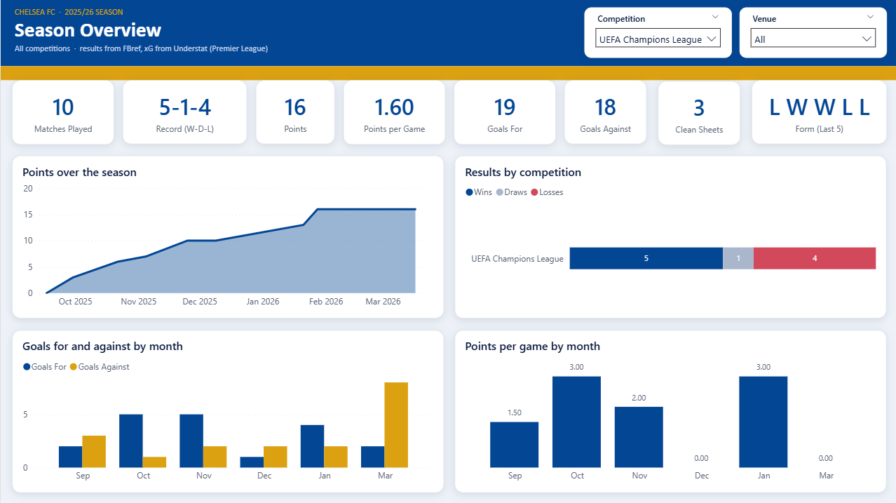
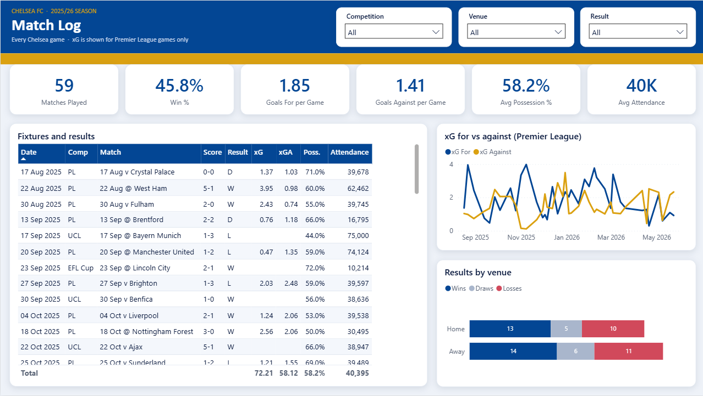
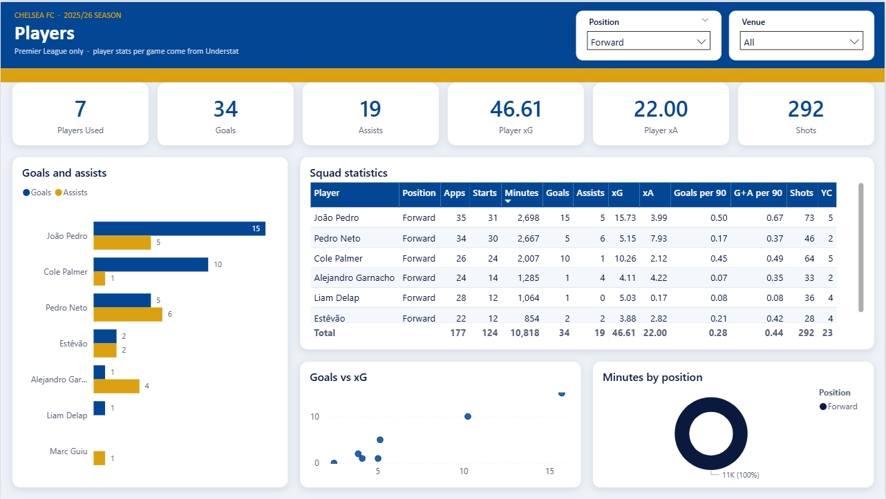

# Chelsea 2025/26 Season Dashboard

A data project about Chelsea's 2025/26 season. I collected match and player stats with
Python, stored them in a PostgreSQL database and built a Power BI dashboard on top.

**Tools:** Python, PostgreSQL, SQL, Power BI, pytest

## The dashboard

It has 3 pages.

### Season Overview

Matches played, record, points, goals, clean sheets, last 5 results, points over the
season, results by competition, and goals and points per game by month.


*Season Overview, filtered to the Champions League.*

### Match Log

Every game with the score, result, xG, possession and attendance. You can filter by
competition, home/away and result.



### Players

Premier League stats for every player (minutes, goals, assists, xG, xA, shots), top
scorers and assisters, goals vs xG, and minutes by position.


*Players page, filtered to forwards.*

## The season in numbers

| | |
|---|---|
| Games played | 59 (Premier League, Champions League, FA Cup, EFL Cup) |
| Record | 27 wins, 11 draws, 21 losses |
| Goals | 109 scored, 83 conceded |
| Clean sheets | 15 |
| Premier League | 14 wins, 10 draws, 14 losses, 52 points |
| Top scorer (PL) | João Pedro, 15 goals and 5 assists |

## How it works

```
Understat + FBref  ->  Python  ->  PostgreSQL  ->  Power BI
```

1. **Collect**: Python downloads Premier League results, xG and player stats from
   Understat. Results for the other competitions, plus possession, attendance and
   referees, come from FBref.
2. **Clean**: team names are made the same in both sources (e.g. "Manchester Utd" and
   "Manchester United"), so the same game isn't counted twice.
3. **Load**: everything goes into a PostgreSQL star schema. That's 2 fact tables (one row
   per match, one row per player per match) and dimension tables for dates, competitions,
   opponents and players.
4. **Report**: SQL views work out results, points and match labels, and Power BI reads
   those views.

The data is checked with pytest tests and SQL quality checks, for example no duplicate
games and 11 starters in every match.

## Project files

```
etl/          Python code: download, clean and load the data
scripts/      scripts to create the database and run the load
sql/          tables, Power BI views and data quality checks
powerbi/      the Power BI dashboard
tests/        tests for the code
```

## Notes

- xG and player stats are for Premier League games only, because Understat only covers the league.
- The FA Cup final was at a neutral ground, and I counted it as a home game.
- Data sources: [Understat](https://understat.com) and [FBref](https://fbref.com).
